# Programacion-web
Trabajo Práctico de Diseño UI/UX realizado en Figma.
## Descripción del Proyecto
# Kora Hair - Tu Brújula Capilar
Diseño completo de interfaz de usuario para la plataforma web del salón capilar y boutique Kora Hair. El proyecto incluye las 12 secciones principales maquetadas:
- Inicio
- Sobre mí
- Servicios
- Detalle de Servicio
- Agendar Turnos
- Boutique
- Detalle de Producto
- Carrito
- Test
- Contacto
- Login
- Registro

TRABAJO PRACTICO NRO 3
# Kora Hair - Sitio Web

Sitio web desarrollado para el salón de estética capilar **Kora Hair**. El proyecto combina diseño UI/UX personalizado (Figma) con un desarrollo web responsivo, optimizado y accesible.

## 🚀 Tecnologías Utilizadas
* **HTML5** (Estructura semántica de vistas)
* **Bootstrap 5.3** (Framework CSS y componentes responsivos)
* **CSS3 Custom Properties** (Estilos y paleta de colores de marca)
* **Git & GitHub** (Control de versiones, ramas y Pull Requests)

## 📱 Vistas del Proyecto
El sitio cuenta con 10 vistas maquetadas:
1. `index.html` (Inicio / Hero principal)
2. `servicios.html` (Catálogo de tratamientos capilares)
3. `detalle-servicio.html` (Información detallada de un servicio)
4. `boutique.html` (Tienda online de productos capilares)
5. `detalle-producto.html` (Vista individual de producto)
6. `carrito.html` (Gestión de compras)
7. `turnos.html` (Sistema de reserva de turnos)
8. `test.html` (Brújula capilar / Test interactivo)
9. `sobre-mi.html` (Presentación y bioseguridad del salón)
10. `contacto.html` (Medios de contacto y ubicación)

## 📊 Auditoría y Rendimiento (Lighthouse)

## Sitio de produccion estatica GitHub Pages
https://abigail-aramayo.github.io/Programacion-web/

---

# TRABAJO PRACTICO NRO 4
## Migración a PHP, Modularización (SSI) y SSR

Se evolucionó la maqueta estática del TP3 (HTML + Bootstrap) a una aplicación PHP:

- Las 12 pantallas pasaron de `.html` a `.php`.
- El `<head>`, el menú de navegación y el pie de página se extrajeron a plantillas reutilizables en `includes/` y se incluyen con `require_once` (Server Side Includes).
- El título de cada página (`<title>`) y el ítem activo del menú se generan dinámicamente desde el servidor (SSR).
- Los datos globales (nombre de la empresa, email de contacto y entorno) se leen de un archivo `.env` que **no se sube a Git**; el repositorio incluye `.env.example` como plantilla.

### Estructura del proyecto

```text
Programacion-web/
├── config/
│   └── env.php          
├── includes/
│   ├── header.php        
│   ├── nav.php          
│   └── footer.php        
├── css/  js/  img/  docs/capturas/
├── index.php  sobre-mi.php  servicios.php  detalle-servicios.php
├── turnos.php  boutique.php  detalle-del-producto.php  carrito.php
├── test.php  contacto.php  login.php  registro.php
├── .env                  
├── .env.example         
├── .gitignore
└── .htaccess          
```

### Instalación y ejecución local

1. Instalar [XAMPP](https://www.apachefriends.org/) (con PHP 8.x).
2. Clonar el repositorio dentro de `C:\xampp\htdocs`:
   ```bash
   cd C:\xampp\htdocs
   git clone https://github.com/Abigail-Aramayo/Programacion-web.git
   cd Programacion-web
   ```
3. Crear el archivo de variables de entorno:
   ```bash
   copy .env.example .env
   ```
4. Iniciar **Apache** desde el Panel de Control de XAMPP.
5. Abrir **http://localhost/Programacion-web/index.php**

### Variables de entorno

| Variable    | Descripción                       | Ejemplo                |
|-------------|-----------------------------------|------------------------|
| `APP_NAME`  | Nombre de la empresa / aplicación | `Kora Hair`            |
| `APP_EMAIL` | Email de soporte / contacto       | `contacto@ejemplo.com` |
| `APP_ENV`   | Entorno de ejecución              | `local`                |

### Evidencia de funcionamiento

**Servidor local ejecutándose**


**Estructura modular (SSI)**


**Navegación dinámica (título de pestaña y clase `active`)**


**Variables de entorno**


### Flujo de trabajo con Git
- Rama de trabajo: `feature/migracion-php-ssi`, integrada a `main` mediante Pull Request.
- Commits atómicos y descriptivos.

### TRABAJO PRACTICO NRO 5

# CLASE 5 – Procesamiento de Formularios y Seguridad Web

**Unidad 4 – Programación del Lado Servidor (PHP)** 

## 1. Objetivo

Sobre el proyecto **Kora Hair** (maquetación responsive + estructura modular en PHP), se agregó la lógica del lado del servidor para **recibir y procesar datos de formularios** con los métodos **POST** y **GET**, aplicando **sanitización** y **validación** para prevenir ataques **XSS** (OWASP Top 10).

Todo el desarrollo de esta entrega está en la carpeta [`clase5/`](./clase5).

## 2. Formularios creados

| | Formulario de contacto | Buscador |
|---|---|---|
| **Método** | **POST** | **GET** |
| **Archivo** | [`clase5/contacto.php`](./clase5/contacto.php) | [`clase5/buscar.php`](./clase5/buscar.php) |
| **Para qué sirve** | Enviar una consulta al salón | Buscar servicios y productos del sitio |
| **Campos** | Nombre, Apellido, Email, Motivo de consulta, Mensaje | Texto a buscar (`q`) y Categoría |
| **Por qué ese método** | Los datos viajan en el cuerpo de la petición (no se ven en la URL) y el envío es una acción | Una búsqueda no modifica nada y el resultado se puede copiar y compartir como link (`buscar.php?q=nutri`) |

### 2.1 Formulario de contacto (POST)

Validaciones que se hacen en el servidor:

| Campo | Regla |
|---|---|
| Nombre y Apellido | Obligatorios, de 2 a 50 caracteres, solo letras y espacios |
| Email | Obligatorio y con formato válido (`filter_var` con `FILTER_VALIDATE_EMAIL`) |
| Motivo | Debe ser una de las opciones de la lista |
| Mensaje | Obligatorio, de 10 a 1000 caracteres |

### 2.2 Buscador (GET)

| Campo | Regla |
|---|---|
| Texto (`q`) | Obligatorio, de 2 a 50 caracteres |
| Categoría | Debe ser `todos`, `servicios` o `productos`; si llega otro valor se usa `todos` |

El buscador busca el texto dentro de los servicios y productos (`config/catalogo.php`) y muestra la cantidad de resultados.

## 3. Cómo se procesan los datos (seguridad)

Cada formulario sigue el mismo recorrido:

1. **Capturar:** se verifica el método (`$_SERVER['REQUEST_METHOD']`) y se leen los datos con `isset()` y `trim()`.
2. **Sanitizar:** se limpian las entradas con `strip_tags()` y `filter_var(..., FILTER_SANITIZE_EMAIL)`.
3. **Validar:** se comprueba con `empty()`, largo mínimo/máximo, `FILTER_VALIDATE_EMAIL` y listas de valores permitidos.
4. **Responder:** se muestra un mensaje de éxito o la lista de errores.
5. **Escapar al mostrar:** todo dato del usuario que se imprime pasa por `htmlspecialchars()`.

| Función de PHP | Para qué se usa en el proyecto |
|---|---|
| `trim()` | Quitar espacios al inicio y al final de lo que escribe el usuario |
| `isset()` / `empty()` | Verificar que el campo exista y que no llegue vacío |
| `strip_tags()` | Eliminar etiquetas HTML (por ejemplo `<script>`) de los textos |
| `filter_var()` | Sanitizar y validar el email |
| `htmlspecialchars()` | Convertir caracteres especiales en texto inofensivo al mostrarlos (función `e()`) |

Las funciones propias están en [`clase5/includes/formularios.php`](./clase5/includes/formularios.php) (`capturar()`, `sanitizar_texto()`, `largo()`) y `e()` está en `clase5/config/env.php`.

**Prevención de XSS – ejemplo:** si alguien escribe `<script>alert(1)</script>` en un campo, el script **no se ejecuta**: primero se eliminan las etiquetas y, además, al imprimir se escapan los caracteres especiales. Se ve en la captura 4.

## 4. Mensajes y persistencia

- **Mensajes:** si el envío es correcto aparece un mensaje verde; si hay errores aparece un cuadro rojo con la lista de lo que hay que corregir y los campos con error se resaltan.
- **Persistencia:** si hay un error, los campos conservan lo que el usuario ya escribió (`value="<?= e($datos['nombre']) ?>"`), para no tener que volver a escribir todo.
- Se usa `novalidate` en los formularios para que la validación que responda sea la del servidor (PHP) y no solo la del navegador.

## 5. Capturas de pantalla

**1. Formulario de contacto (POST)**


**2. Validación: errores en pantalla y campos conservados**
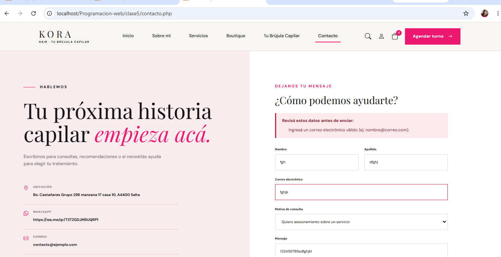

**3. Envío exitoso: mensaje de confirmación**


**4. Prevención de XSS: el script ingresado no se ejecuta**


**5. Buscador (GET): resultados y parámetros en la URL (`?q=nutri`)**


**6. Buscador: validación de búsqueda inválida**
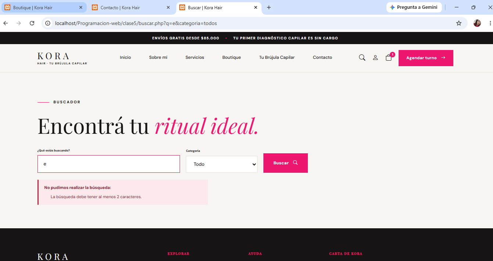


## TRABAJO PRÁCTICO Nº 6 – Bases de Datos: Normalización y SQL

Diseño de la base de datos de **Kora Hair** (turnos y boutique), aplicando normalización y comandos SQL (DDL y CRUD) en MySQL.

### Archivos
| Archivo | Contenido |
|---|---|
| `tp6/NORMALIZACION.md` | Tabla sin normalizar, proceso 1FN → 2FN → 3FN y listado final de tablas |
| `tp6/schema.sql` | DDL: creación de la base, las 11 tablas, claves, relaciones e índices |
| `tp6/consultas.sql` | DML: CRUD completo (INSERT, SELECT, UPDATE, DELETE) |

### 1. Normalización
Se partió de una tabla de pedidos con campos multivalorados (productos, cantidades y precios en una sola celda) y se normalizó:
- **1FN:** un valor por celda, una fila por producto del pedido.
- **2FN:** se eliminan dependencias parciales → `pedidos`, `productos`, `detalle_pedidos`.
- **3FN:** se eliminan dependencias transitivas → `categorias`, `usuarios`, `roles`, `estados_pedido`.

Resultado: **11 tablas** — `roles`, `usuarios`, `categorias`, `productos`, `servicios`, `estados_turno`, `turnos`, `estados_pedido`, `pedidos`, `detalle_pedidos` y `consultas`.

Relaciones principales:
- 1:N: categoría → productos, usuario → turnos, usuario → pedidos, rol → usuarios.
- N:M: pedidos ↔ productos, resuelta con la tabla intermedia `detalle_pedidos`.

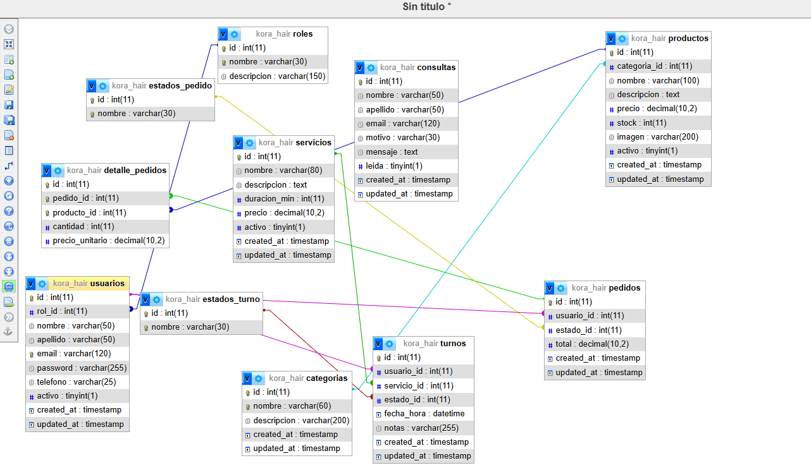

### 2. Creación de la base (DDL)
`schema.sql` crea la base `kora_hair` (utf8mb4) y las tablas con clave primaria autoincremental, claves foráneas, restricciones `NOT NULL` y `UNIQUE`, campos `created_at` / `updated_at` e índices.

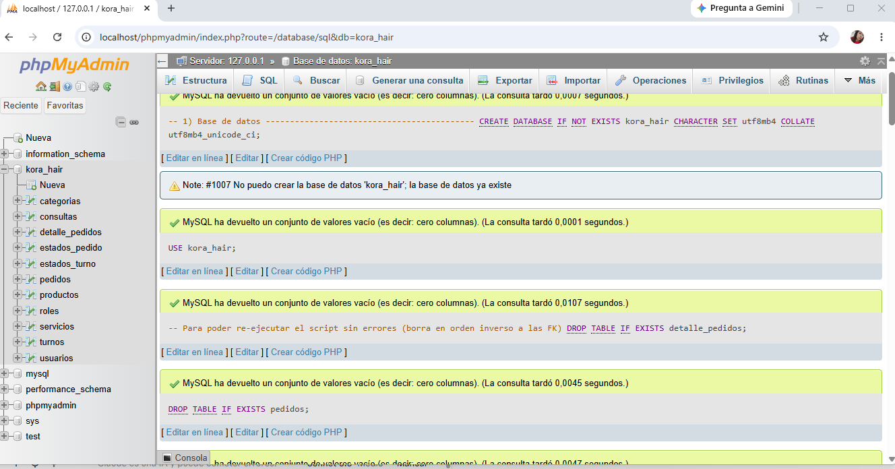

### 3. CRUD (DML)
**Create (INSERT):** carga de roles, categorías, estados, usuarios, productos, turnos, un pedido con su detalle y una consulta de prueba. Las contraseñas se guardan como hash.

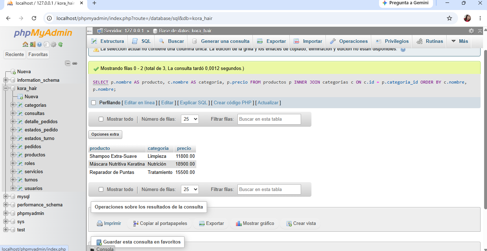

**Read (SELECT):**
1. `WHERE` + `ORDER BY`: productos de más de $12.000, del más caro al más barato.
2. `INNER JOIN`: productos con su categoría.
3. `INNER JOIN` de 4 tablas: turnos con cliente, servicio y estado.
4. Detalle de un pedido (relación N:M) con subtotal.


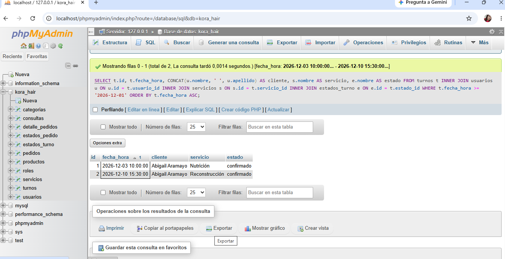


**Update:** cambio de precio de un producto y confirmación de un turno, siempre con `WHERE`.

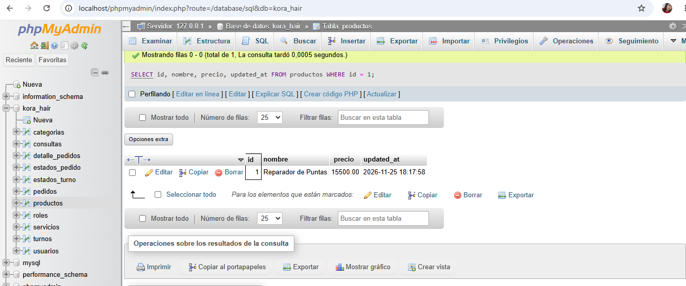

**Delete:** baja de una consulta de prueba con `WHERE`; la comprobación devuelve 0 filas.


### Cómo reproducirlo
1. Iniciar Apache y MySQL en XAMPP y abrir `http://localhost/phpmyadmin`.
2. Pestaña **SQL**: ejecutar `tp6/schema.sql`.
3. Ejecutar `tp6/consultas.sql` por bloques (C, R, U, D).

---

# TP7 – Persistencia y Conexión PHP-MySQL Segura

**Unidad 4 – Programación del Lado Servidor (PHP)** 

## 1. Objetivo

Se conectó el sitio **Kora Hair** con la base de datos MySQL diseñada en el TP6 (`kora_hair`) usando **PDO**, y se construyó un módulo **CRUD de productos** de la boutique integrado al diseño del sitio, con **consultas preparadas** (anti SQL Injection) y **protección XSS** (`htmlspecialchars`).

## 2. Módulo de administración (CRUD de productos)

| Operación | Archivo | Qué hace |
|---|---|---|
| **Read** (leer) | [`admin/index.php`](./admin/index.php) | Lista los productos con su categoría (INNER JOIN) |
| **Create** (crear) | [`admin/crear.php`](./admin/crear.php) | Formulario + `INSERT` preparado |
| **Update** (editar) | [`admin/editar.php`](./admin/editar.php) | Carga el producto + `UPDATE` preparado |
| **Delete** (eliminar) | [`admin/eliminar.php`](./admin/eliminar.php) | `DELETE` preparado (solo por POST y con confirmación) |
| Lectura de consultas | [`admin/consultas.php`](./admin/consultas.php) | Muestra los mensajes enviados desde el formulario de contacto |

Además, el formulario de **contacto** (`contacto.php`) ahora guarda cada mensaje en la tabla `consultas`: el flujo completo va desde el formulario de la interfaz hasta la base de datos.

La tabla que se manipula es `productos` del modelo del TP6 (relacionada con `categorias` por `categoria_id`).

## 3. Conexión segura

[`config/conexion.php`](./config/conexion.php) crea el objeto PDO con:
- `try/catch (PDOException)` para que un fallo de conexión no muestre claves ni rutas internas.
- `PDO::ERRMODE_EXCEPTION` (los errores lanzan excepciones), `FETCH_ASSOC` y `EMULATE_PREPARES = false` (consultas preparadas reales).
- Los datos de conexión (`DB_HOST`, `DB_NAME`, `DB_USER`, `DB_PASS`) se leen del archivo `.env`, que no se sube a GitHub.

## 4. Seguridad aplicada

| Amenaza | Medida |
|---|---|
| Inyección SQL | **Consultas preparadas** con `:parametros` en todos los INSERT, UPDATE, SELECT y DELETE que reciben datos del usuario |
| XSS | `htmlspecialchars()` (función `e()`) en todo lo que se imprime + `strip_tags()` al recibir el texto |
| Datos inválidos | Validación en servidor: `filter_var` para id, precio y stock; la categoría debe existir en la base |
| Borrado accidental | El borrado se envía por **POST** con confirmación (un link GET podría ejecutarse sin querer) |
| Integridad | Si un producto figura en pedidos (clave foránea), se avisa que no se puede eliminar en lugar de mostrar un error |

## 5. Cómo ejecutarlo

1. Iniciar **Apache** y **MySQL** en XAMPP.
2. En `http://localhost/phpmyadmin` → pestaña **SQL**: ejecutar [`database/schema.sql`](./database/schema.sql) y después [`database/consultas.sql`](./database/consultas.sql) (cargan la estructura y los datos de prueba).
3. Copiar `.env.example` como `.env` (en XAMPP: usuario `root`, contraseña vacía).
4. Abrir `http://localhost/Programacion-web/admin/index.php`.

## 6. Capturas de pantalla

**1. Listado de productos (Read)**


**2. Alta de un producto (Create)**
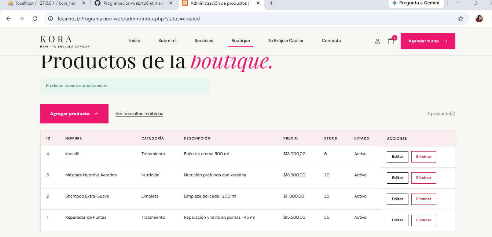

**3. Edición de un producto (Update)**


**4. Baja de un producto (Delete)**
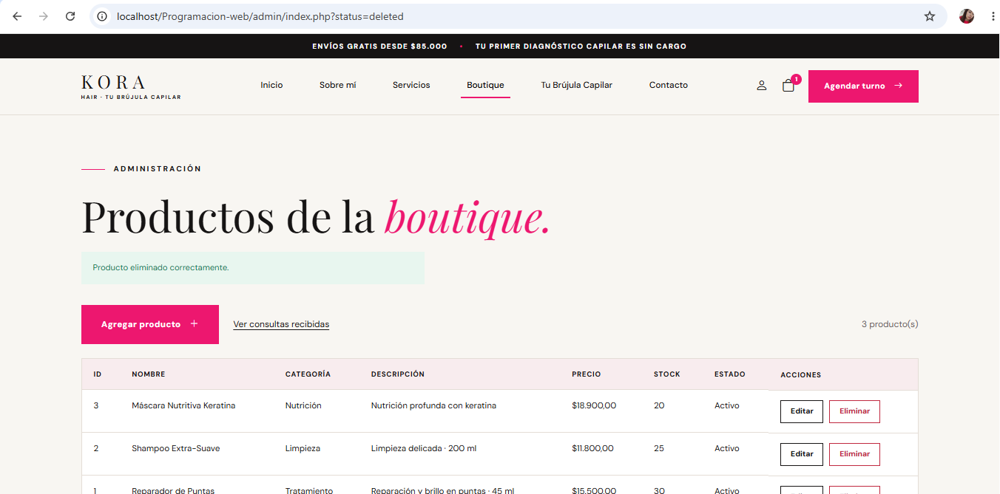

**5. Los datos reflejados en phpMyAdmin**
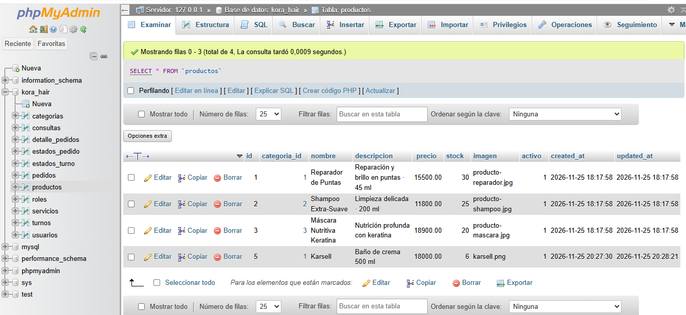

## TRABAJO PRÁCTICO Nº 8 – Manejo de Estado, Sesiones y Autenticación

Sistema de login para **Kora Hair**: registro, inicio y cierre de sesión, páginas protegidas y control de acceso por rol.

### Archivos
| Archivo | Función |
|---|---|
| `config/sesion.php` | `iniciar_sesion()` (cookie httponly/samesite, modo estricto) y token CSRF |
| `includes/auth_guard.php` | Guardián de rutas: sin sesión → login; rol incorrecto → panel |
| `registro.php` | Alta de usuario: sanitiza, valida, email único, `password_hash()` |
| `login.php` | `password_verify()`, `session_regenerate_id(true)`, datos en `$_SESSION` |
| `logout.php` | Vacía `$_SESSION`, borra la cookie y hace `session_destroy()` |
| `panel.php` | Página protegida para cualquier usuario logueado |
| `admin_panel.php` | Página protegida solo para el rol `admin` |
| `admin/*.php` | El CRUD del TP7 ahora exige rol `admin` |
| `database/tp8_ajustes.sql` | Ajustes de BD (rol `usuario`, apellido opcional) |

### Seguridad aplicada
- Contraseñas con **bcrypt** (`password_hash`), nunca en texto plano.
- **Consultas preparadas** (PDO) en login y registro.
- Mensaje genérico en el login ("Correo o contraseña incorrectos") para no revelar qué correos existen.
- **Regeneración del ID de sesión** al loguearse (anti fijación de sesión).
- Cookie de sesión `httponly` + `samesite=Lax` (+ `secure` si hay HTTPS).
- **Token CSRF** en los formularios de login y registro.
- Salida escapada con `htmlspecialchars` (helper `e()`).
- Verificación de **rol** en el servidor, no solo ocultando links.

### Cómo probar
1. Importar `database/schema.sql` y `database/consultas.sql`, y luego `database/tp8_ajustes.sql`.
2. Admin de prueba: `admin@korahair.test` · contraseña `Kora1234!`
3. Usuario común: `abigail@correo.test` · contraseña `Kora1234!` (o registrarse en `registro.php`).
4. Sin sesión, abrir `panel.php` o `admin/index.php` → redirige a `login.php`.
5. Con usuario común, abrir `admin_panel.php` → redirige a `panel.php` con aviso de permisos.
### Capturas

**1. Cierre de sesión (`logout.php`)**
Al cerrar sesión se destruye la sesión en el servidor, se borra la cookie y se redirige al login con un aviso.
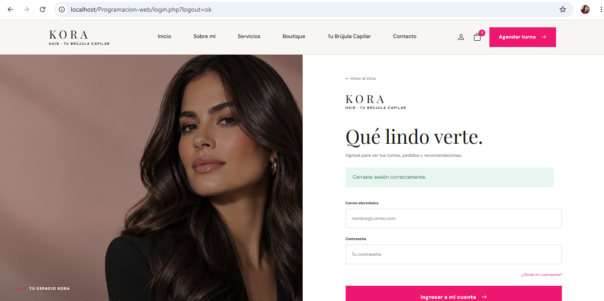

**2. Registro con validación (`registro.php`)**
El servidor valida los datos y muestra los errores sin perder lo escrito. Acá, una contraseña de menos de 8 caracteres.
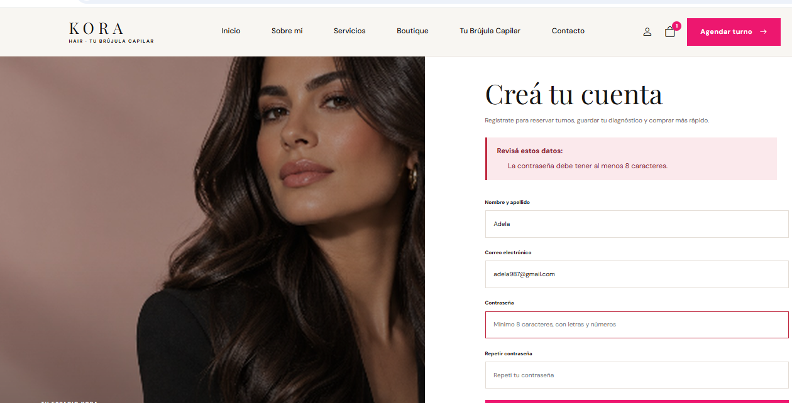

**3. Panel del usuario (`panel.php`)**
Página protegida: solo se ve con sesión iniciada. Muestra el nombre, el correo y el rol `usuario`.
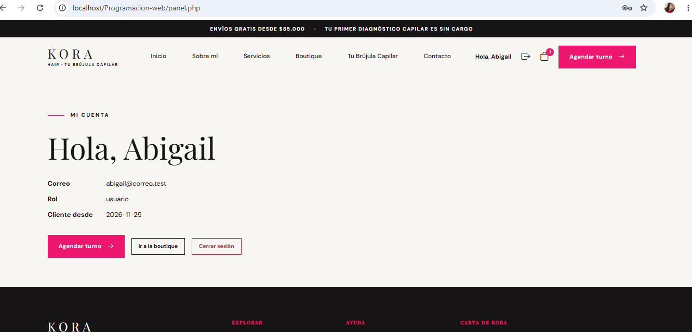

**4. Panel de administración (`admin_panel.php`)**
Solo accesible con el rol `admin`. Muestra el resumen del sitio y los accesos al CRUD del TP7.
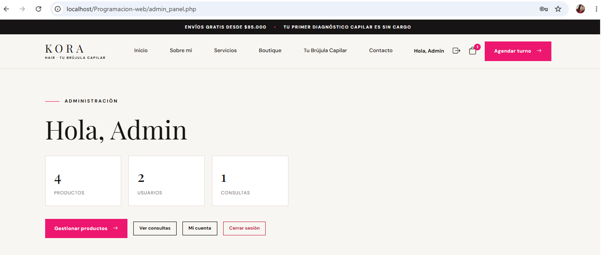

**5. Acceso denegado (guardián de rutas)**
Al abrir una página protegida sin sesión, `auth_guard.php` redirige al login con un aviso.


**6. Contraseñas encriptadas en la base de datos**
La columna `password` guarda el hash bcrypt (`$2y$10$...`), nunca la contraseña en texto plano. Cada usuario tiene un hash distinto.
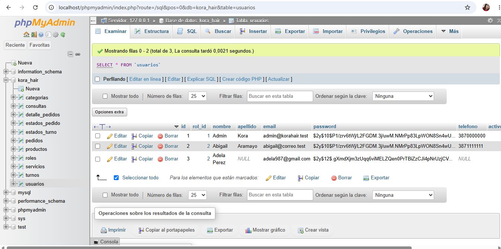

**7. Error de login genérico**
Si falla el correo o la contraseña, el mensaje es el mismo, para no revelar qué correos están registrados.


**8. Registro exitoso**
Tras crear la cuenta se redirige al login con la confirmación.


## TRABAJO PRÁCTICO Nº 9 – Comunicación Asincrónica y APIs (AJAX & JSON)

**Unidad 5 – Interacción Avanzada y Frameworks** 

### Objetivo
Se agregó a la **boutique** de Kora Hair un buscador en vivo: al escribir o elegir una categoría, la página pide los productos al servidor con **Fetch API**, recibe **JSON** y actualiza solo la grilla, **sin recargar la página**.

### Archivos
| Archivo | Función |
|---|---|
| [`api/buscar_productos.php`](./api/buscar_productos.php) | Endpoint PHP: consulta con PDO y responde JSON con el código HTTP adecuado |
| [`js/buscador.js`](./js/buscador.js) | Evento `input`, `fetch` con `async/await`, `try/catch` y manipulación del DOM |
| [`boutique.php`](./boutique.php) | Campo de búsqueda y contenedor `#gridProductos` que se completa con los datos |
| [`config/conexion.php`](./config/conexion.php) | Si la conexión falla desde la API, responde JSON (no HTML) |

### 1. Backend: endpoint JSON
- Cabecera `Content-Type: application/json; charset=utf-8`.
- Consulta con **PDO y consultas preparadas** (`:q1`, `:q2`, `:cat`, `:id`); los comodines `%` y `_` del usuario se escapan.
- Parámetros opcionales por GET: `q` (búsqueda), `categoria` (`nutricion`, `limpieza`, `tratamiento`) e `id`.
- Respuesta con `json_encode()`: `{ "status": "success", "total": 1, "data": [ ... ] }`.

| Código | Cuándo |
|---|---|
| **200 OK** | Consulta correcta (con resultados o lista vacía) |
| **400 Bad Request** | Búsqueda de más de 60 caracteres, parámetro no válido o `id` no numérico |
| **404 Not Found** | `id` inexistente o categoría que no existe |
| **405 Method Not Allowed** | Se usó un método distinto de GET |
| **500 Internal Server Error** | Falla de la base de datos (el detalle queda en el log, no se muestra) |

### 2. Frontend: Fetch API
- Se captura el evento `input` del buscador (con *debounce* de 300 ms para no pedir en cada tecla) y el `click` de los filtros por categoría.
- Petición con `fetch()` y `async/await`; si la respuesta no es `ok` se lanza un error y se muestra un mensaje.
- Un `AbortController` cancela la petición anterior si el usuario sigue escribiendo.
- Errores de red o HTTP controlados con `try...catch`.

### 3. Manipulación dinámica del DOM
- Se procesa el JSON, se recorre con `.map()` y se construyen las tarjetas de producto.
- Solo se reemplaza el contenido de `#gridProductos` y el contador de resultados; el resto de la página no se toca.
- Las tarjetas se crean con `createElement` y `textContent` (no `innerHTML`), para evitar **XSS** si un dato trae HTML.
- Si no hay resultados o hay un error, se muestra un mensaje en la misma sección.

### Cómo probarlo
1. Iniciar Apache y MySQL en XAMPP (la base `kora_hair` ya cargada).
2. Abrir `http://localhost/Programacion-web/boutique.php` y escribir en el buscador (por ejemplo `keratina`).
3. Ver el JSON crudo: `http://localhost/Programacion-web/api/buscar_productos.php?q=keratina`
4. Probar los errores: `api/buscar_productos.php?id=999` (404) y `api/buscar_productos.php?id=abc` (400).
5. En las herramientas del navegador (F12 → Network → Fetch/XHR) se ve la petición sin recarga de página.

### Capturas
**1. Boutique cargada desde la base de datos**
Los productos llegan por JSON y se dibujan en la grilla.
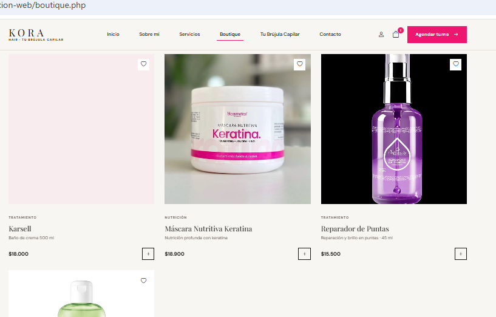

**2. Búsqueda en vivo**
Al escribir `sha`, la grilla muestra solo el producto que coincide, sin recargar.
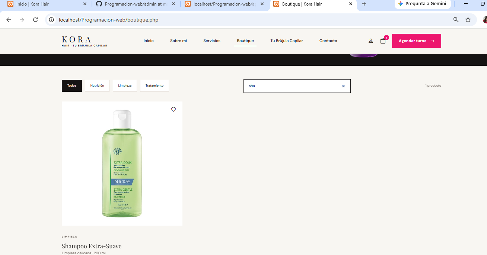

**3. Búsqueda sin resultados**
El servidor devuelve una lista vacía y la página muestra un mensaje.
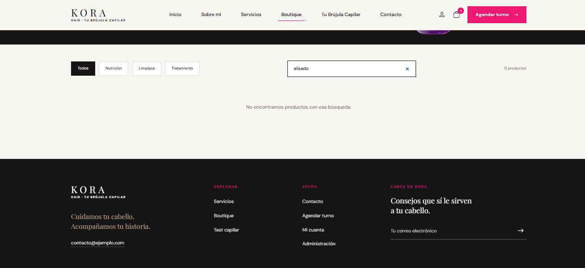

**4. Respuesta JSON del endpoint**
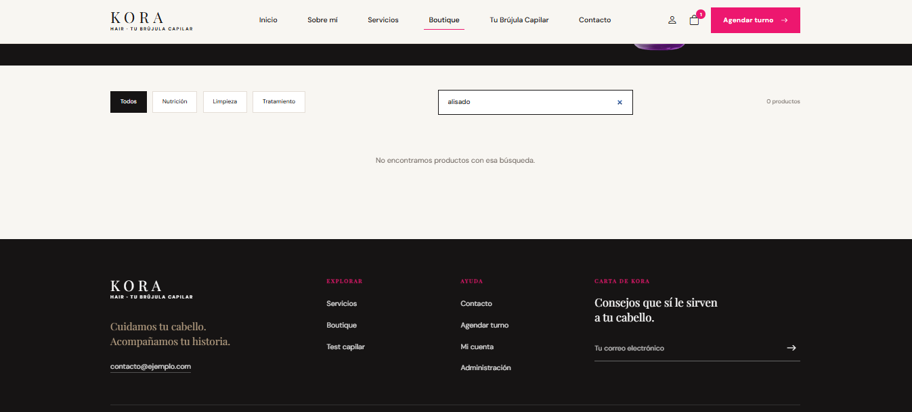

**5. Petición Fetch en segundo plano (DevTools → Red)**
Cada letra genera una petición `fetch` con estado 200, sin recargar la página.
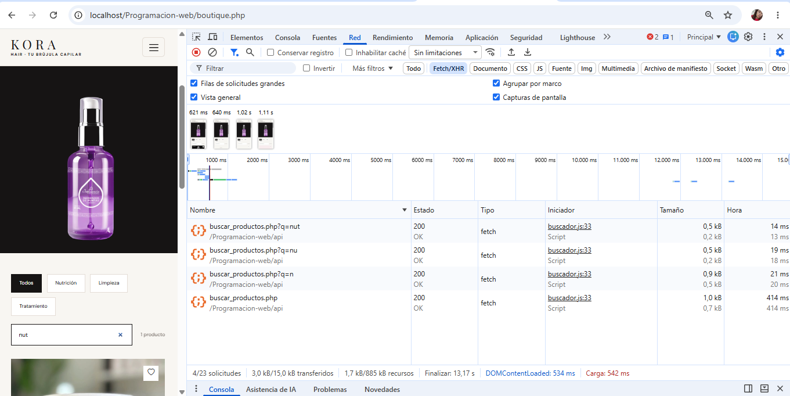

**6. Error 404 controlado**
Un `id` inexistente devuelve JSON con el estado de error.
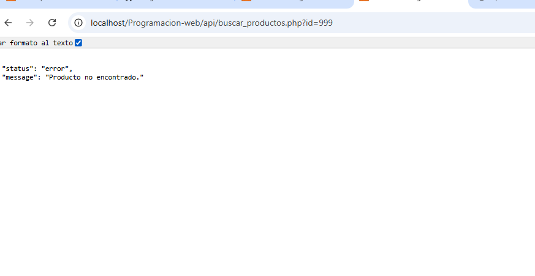

## TRABAJO PRÁCTICO Nº 10 – Refactorización a MVC e implementación con Framework

**Unidad 5 – Interacción Avanzada y Frameworks** 

### Objetivo
Aplicar el patrón **Modelo-Vista-Controlador (MVC)**: primero reorganizando un módulo propio en PHP puro (Parte A) y después construyendo un módulo nuevo con un framework profesional, **CodeIgniter 4** (Parte B).

| Capa | Responsabilidad |
|---|---|
| **Modelo** | Acceso a datos: todo el SQL (PDO / Query Builder). No conoce HTML ni `$_GET`/`$_POST`. |
| **Vista** | Marcado HTML. Solo muestra los datos que recibe. |
| **Controlador** | Recibe la solicitud, valida, le pide datos al modelo y elige la vista. |

---

## Parte A – Refactorización nativa (PHP puro)

**Módulo elegido:** catálogo de productos (el CRUD de administración del TP7, protegido por el login del TP8).

### Antes y después
| Antes (TP7) | Después (TP10) |
|---|---|
| `admin/index.php`, `crear.php`, `editar.php`, `eliminar.php` mezclaban SQL, validación y HTML en el mismo archivo | Cada archivo de `admin/` solo protege la página y llama al controlador (4 líneas) |
| `admin/_validar.php` y `admin/_form.php` | La validación pasó al controlador y el formulario a una vista parcial |

### Estructura
```
app/
├── autoload.php                      Carga automática de clases (App\Models\... -> app/Models/...)
├── Core/Controller.php               Controlador base: render() y redirigir()
├── Models/
│   ├── ProductoModel.php             SQL de productos (consultas preparadas)
│   └── CategoriaModel.php            SQL de categorías
├── Controllers/
│   └── ProductoController.php        index · crear · editar · eliminar
└── Views/productos/
    ├── listado.php                   Tabla de productos
    ├── crear.php / editar.php        Páginas de alta y modificación
    └── _formulario.php               Formulario compartido
admin/                                Puntos de entrada (index, crear, editar, eliminar)
```


## Parte B – Módulo con framework (CodeIgniter 4)

**Módulo:** *Catálogo Kora Hair*, independiente del sitio, en la carpeta [`kora-framework/`](./kora-framework). Usa la misma base de datos `kora_hair` y tiene dos partes: páginas HTML y una **API REST** que devuelve JSON.

### Lo que se configuró en el framework
| Elemento | Archivo | Qué hace |
|---|---|---|
| **Routing** | `app/Config/Routes.php` | `catalogo`, `catalogo/(:num)`, `api/productos`, `api/productos/(:num)` |
| **Controlador** | `app/Controllers/Catalogo.php` | Páginas HTML (listado con filtro por categoría y detalle) |
| **Controlador** | `app/Controllers/ApiProductos.php` | Respuestas JSON con código 200 / 404 |
| **Modelo** | `app/Models/ProductoModel.php`, `CategoriaModel.php` | Extienden `CodeIgniter\Model`; consultas con el **Query Builder** (`select`, `join`, `where`, `selectCount`, `selectAvg`...) |
| **Vistas** | `app/Views/layouts/principal.php`, `catalogo/index.php`, `catalogo/detalle.php` | Motor de plantillas de CI4: `extend`, `section`, `renderSection`, `esc()` |

### URLs del módulo
| URL | Qué muestra |
|---|---|
| `/catalogo` | Listado de productos + reporte (total, stock, precio promedio) |
| `/catalogo?categoria=2` | Listado filtrado por categoría |
| `/catalogo/3` | Detalle de un producto (404 si no existe) |
| `/api/productos` | JSON con todos los productos activos |
| `/api/productos/3` | JSON de un producto (404 si no existe) |

### Cómo ejecutarlo
1. Descargar CodeIgniter 4 (instalación manual) desde <https://github.com/codeigniter4/framework/releases/latest> y extraerlo en `kora-framework/`.
2. Copiar encima los archivos de este módulo (`app/`, `public/`).
3. Copiar el archivo `env` como `.env` y configurar:
   ```
   CI_ENVIRONMENT = development
   app.baseURL = 'http://localhost:8080/'
   database.default.hostname = localhost
   database.default.database = kora_hair
   database.default.username = root
   database.default.password =
   database.default.DBDriver = MySQLi
   database.default.port = 3306
   ```
4. Con MySQL iniciado, desde `kora-framework/`: `C:\xampp\php\php.exe spark serve`
5. Abrir <http://localhost:8080/catalogo>

### Comparación: MVC nativo vs. framework
| | PHP puro (Parte A) | CodeIgniter 4 (Parte B) |
|---|---|---|
| Rutas | Un archivo por página (`admin/editar.php`) | Tabla de rutas centralizada (`Routes.php`) |
| Carga de clases | `spl_autoload_register` escrito a mano | Autoload del framework por namespaces |
| Acceso a datos | PDO con SQL escrito a mano | Query Builder del framework |
| Vistas | `require` de archivos PHP | Plantillas con layouts y secciones |
| Respuestas JSON / 404 | `header()` + `json_encode()` manual | `$this->response->setJSON()`, excepciones de 404 |
| Seguridad | Se programa cada protección | El framework aporta `esc()`, filtros, CSRF configurable |

### Capturas

**1. Módulo admin refactorizado a MVC (Parte A)**
Listado de productos del panel de administración. Ahora `admin/index.php` es solo un punto de entrada: el controlador pide los datos al modelo y se los pasa a la vista.

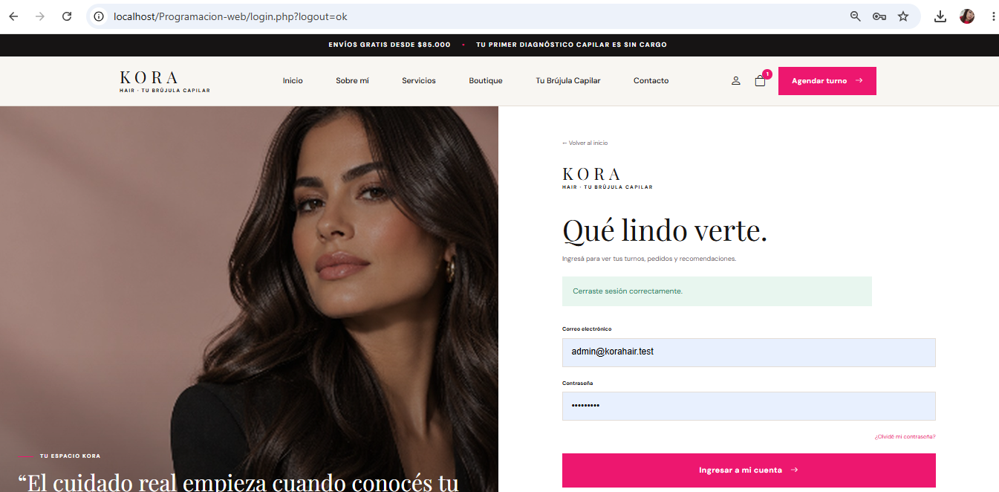

**1b. Estructura MVC propia (`app/`)**
Carpetas `Controllers`, `Core`, `Models` y `Views/productos` más `autoload.php`. Cada capa tiene una única responsabilidad: el modelo con las consultas PDO preparadas, el controlador con la validación y el flujo, y la vista con el HTML.

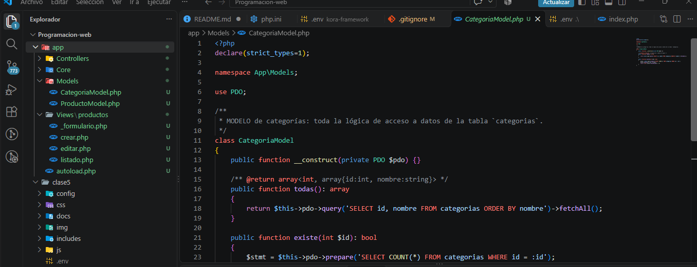

**2. Catálogo con CodeIgniter 4 (`/catalogo`)**
Ruta propia que ejecuta `Catalogo::index`. Las tarjetas de resumen (productos activos, stock total y precio promedio) salen del modelo con el Query Builder (`selectCount`, `selectSum`, `selectAvg`).

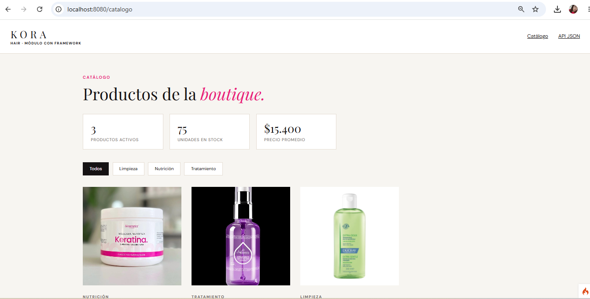

**3. Filtro por categoría (`/catalogo?categoria=2`)**
El controlador recibe la categoría, el modelo hace un `join` con `categorias` y filtra con `where`. La vista marca el botón activo.


**4. Detalle de producto (`/catalogo/3`)**
Ruta con parámetro `(:num)` que llega al método `ver($id)`. La vista usa el layout del framework (`extend` / `section`) y `esc()` para escapar la salida.

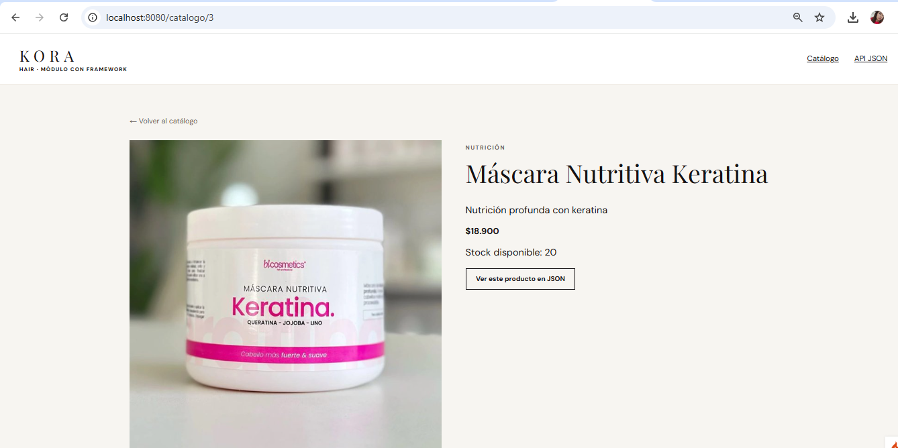

**5. API JSON (`/api/productos`)**
Grupo de rutas `api` que responde con `setJSON()`: estado, total y listado de productos con su categoría.

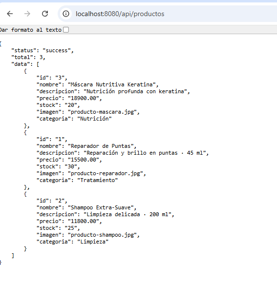

**6. Error controlado (`/api/productos/999`)**
Un producto inexistente devuelve un JSON con `status: error` y el código HTTP 404.

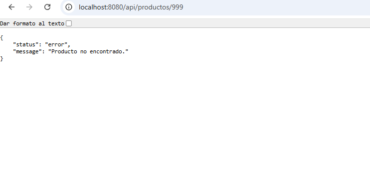

**7. Estructura del proyecto con el framework**
Carpeta `kora-framework` con `app`, `public`, `system` y `writable`. Lo desarrollado es lo que está en `app/` (rutas, controladores, modelos y vistas).

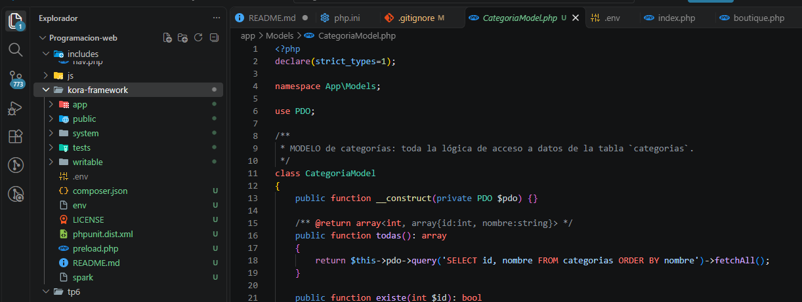
