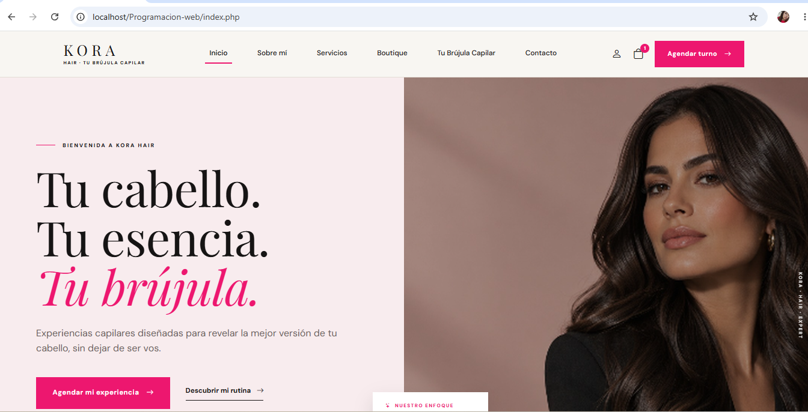
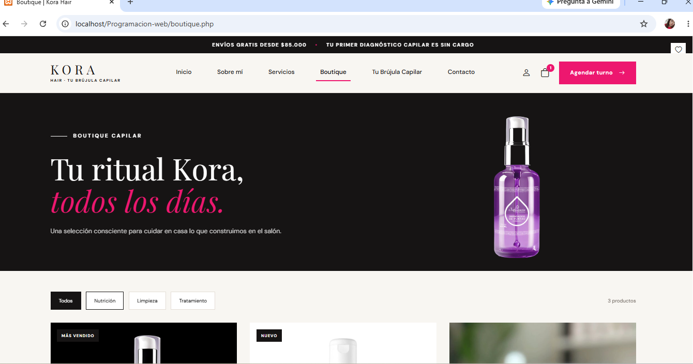
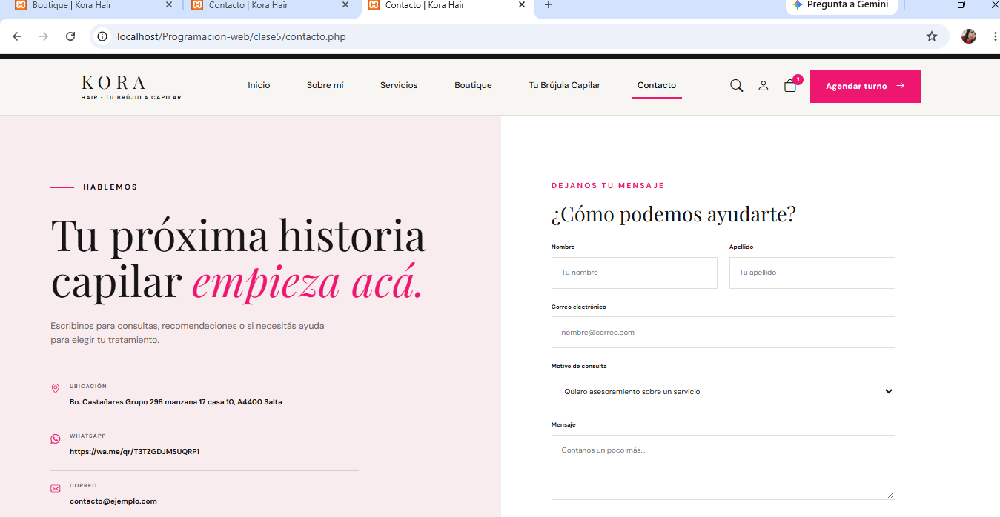
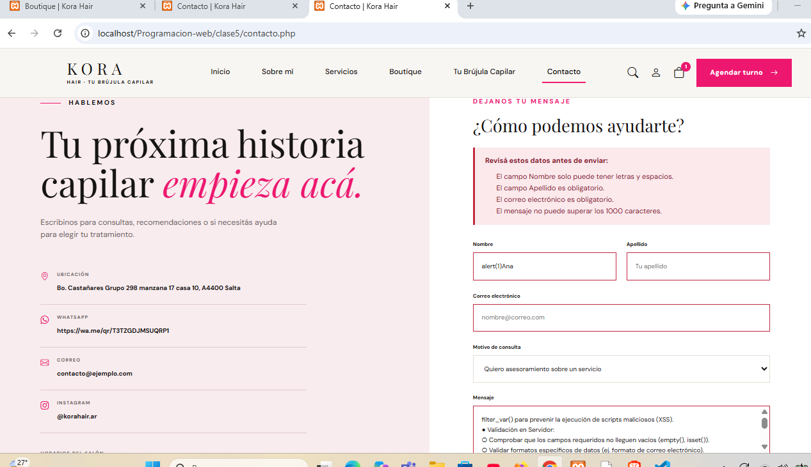
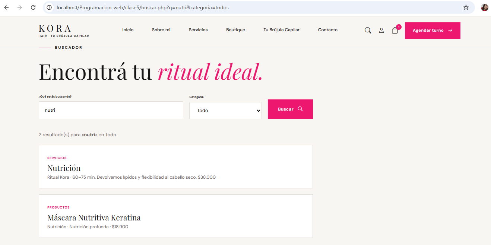

# Programacion-web
Trabajo Práctico de Diseño UI/UX realizado en Figma.
## Descripción del Proyecto
# Kora Hair - Tu Brújula Capilar
Diseño completo de interfaz de usuario para la plataforma web del salón capilar y boutique Kora Hair. El proyecto incluye las 12 secciones principales maquetadas:
- Inicio
- Sobre mí
- Servicios
- Detalle de Servicio
- Agendar Turnos
- Boutique
- Detalle de Producto
- Carrito
- Test
- Contacto
- Login
- Registro

TRABAJO PRACTICO NRO 3
# Kora Hair - Sitio Web

Sitio web desarrollado para el salón de estética capilar **Kora Hair**. El proyecto combina diseño UI/UX personalizado (Figma) con un desarrollo web responsivo, optimizado y accesible.

## 🚀 Tecnologías Utilizadas
* **HTML5** (Estructura semántica de vistas)
* **Bootstrap 5.3** (Framework CSS y componentes responsivos)
* **CSS3 Custom Properties** (Estilos y paleta de colores de marca)
* **Git & GitHub** (Control de versiones, ramas y Pull Requests)

## 📱 Vistas del Proyecto
El sitio cuenta con 10 vistas maquetadas:
1. `index.html` (Inicio / Hero principal)
2. `servicios.html` (Catálogo de tratamientos capilares)
3. `detalle-servicio.html` (Información detallada de un servicio)
4. `boutique.html` (Tienda online de productos capilares)
5. `detalle-producto.html` (Vista individual de producto)
6. `carrito.html` (Gestión de compras)
7. `turnos.html` (Sistema de reserva de turnos)
8. `test.html` (Brújula capilar / Test interactivo)
9. `sobre-mi.html` (Presentación y bioseguridad del salón)
10. `contacto.html` (Medios de contacto y ubicación)

## 📊 Auditoría y Rendimiento (Lighthouse)

## Sitio de produccion estatica GitHub Pages
https://abigail-aramayo.github.io/Programacion-web/

---

# TRABAJO PRACTICO NRO 4
## Migración a PHP, Modularización (SSI) y SSR

Se evolucionó la maqueta estática del TP3 (HTML + Bootstrap) a una aplicación PHP:

- Las 12 pantallas pasaron de `.html` a `.php`.
- El `<head>`, el menú de navegación y el pie de página se extrajeron a plantillas reutilizables en `includes/` y se incluyen con `require_once` (Server Side Includes).
- El título de cada página (`<title>`) y el ítem activo del menú se generan dinámicamente desde el servidor (SSR).
- Los datos globales (nombre de la empresa, email de contacto y entorno) se leen de un archivo `.env` que **no se sube a Git**; el repositorio incluye `.env.example` como plantilla.

### Estructura del proyecto

```text
Programacion-web/
├── config/
│   └── env.php          
├── includes/
│   ├── header.php        
│   ├── nav.php          
│   └── footer.php        
├── css/  js/  img/  docs/capturas/
├── index.php  sobre-mi.php  servicios.php  detalle-servicios.php
├── turnos.php  boutique.php  detalle-del-producto.php  carrito.php
├── test.php  contacto.php  login.php  registro.php
├── .env                  
├── .env.example         
├── .gitignore
└── .htaccess          
```

### Instalación y ejecución local

1. Instalar [XAMPP](https://www.apachefriends.org/) (con PHP 8.x).
2. Clonar el repositorio dentro de `C:\xampp\htdocs`:
   ```bash
   cd C:\xampp\htdocs
   git clone https://github.com/Abigail-Aramayo/Programacion-web.git
   cd Programacion-web
   ```
3. Crear el archivo de variables de entorno:
   ```bash
   copy .env.example .env
   ```
4. Iniciar **Apache** desde el Panel de Control de XAMPP.
5. Abrir **http://localhost/Programacion-web/index.php**

### Variables de entorno

| Variable    | Descripción                       | Ejemplo                |
|-------------|-----------------------------------|------------------------|
| `APP_NAME`  | Nombre de la empresa / aplicación | `Kora Hair`            |
| `APP_EMAIL` | Email de soporte / contacto       | `contacto@ejemplo.com` |
| `APP_ENV`   | Entorno de ejecución              | `local`                |

### Evidencia de funcionamiento

**Servidor local ejecutándose**


**Estructura modular (SSI)**


**Navegación dinámica (título de pestaña y clase `active`)**


**Variables de entorno**


### Flujo de trabajo con Git
- Rama de trabajo: `feature/migracion-php-ssi`, integrada a `main` mediante Pull Request.
- Commits atómicos y descriptivos.

### TRABAJO PRACTICO NRO 5

# CLASE 5 – Procesamiento de Formularios y Seguridad Web

**Unidad 4 – Programación del Lado Servidor (PHP)** · Programación Web · Profesor: Lic. Gabriel Artaza

## 1. Objetivo

Sobre el proyecto **Kora Hair** (maquetación responsive + estructura modular en PHP), se agregó la lógica del lado del servidor para **recibir y procesar datos de formularios** con los métodos **POST** y **GET**, aplicando **sanitización** y **validación** para prevenir ataques **XSS** (OWASP Top 10).

Todo el desarrollo de esta entrega está en la carpeta [`clase5/`](./clase5).

## 2. Formularios creados

| | Formulario de contacto | Buscador |
|---|---|---|
| **Método** | **POST** | **GET** |
| **Archivo** | [`clase5/contacto.php`](./clase5/contacto.php) | [`clase5/buscar.php`](./clase5/buscar.php) |
| **Para qué sirve** | Enviar una consulta al salón | Buscar servicios y productos del sitio |
| **Campos** | Nombre, Apellido, Email, Motivo de consulta, Mensaje | Texto a buscar (`q`) y Categoría |
| **Por qué ese método** | Los datos viajan en el cuerpo de la petición (no se ven en la URL) y el envío es una acción | Una búsqueda no modifica nada y el resultado se puede copiar y compartir como link (`buscar.php?q=nutri`) |

### 2.1 Formulario de contacto (POST)

Validaciones que se hacen en el servidor:

| Campo | Regla |
|---|---|
| Nombre y Apellido | Obligatorios, de 2 a 50 caracteres, solo letras y espacios |
| Email | Obligatorio y con formato válido (`filter_var` con `FILTER_VALIDATE_EMAIL`) |
| Motivo | Debe ser una de las opciones de la lista |
| Mensaje | Obligatorio, de 10 a 1000 caracteres |

### 2.2 Buscador (GET)

| Campo | Regla |
|---|---|
| Texto (`q`) | Obligatorio, de 2 a 50 caracteres |
| Categoría | Debe ser `todos`, `servicios` o `productos`; si llega otro valor se usa `todos` |

El buscador busca el texto dentro de los servicios y productos (`config/catalogo.php`) y muestra la cantidad de resultados.

## 3. Cómo se procesan los datos (seguridad)

Cada formulario sigue el mismo recorrido:

1. **Capturar:** se verifica el método (`$_SERVER['REQUEST_METHOD']`) y se leen los datos con `isset()` y `trim()`.
2. **Sanitizar:** se limpian las entradas con `strip_tags()` y `filter_var(..., FILTER_SANITIZE_EMAIL)`.
3. **Validar:** se comprueba con `empty()`, largo mínimo/máximo, `FILTER_VALIDATE_EMAIL` y listas de valores permitidos.
4. **Responder:** se muestra un mensaje de éxito o la lista de errores.
5. **Escapar al mostrar:** todo dato del usuario que se imprime pasa por `htmlspecialchars()`.

| Función de PHP | Para qué se usa en el proyecto |
|---|---|
| `trim()` | Quitar espacios al inicio y al final de lo que escribe el usuario |
| `isset()` / `empty()` | Verificar que el campo exista y que no llegue vacío |
| `strip_tags()` | Eliminar etiquetas HTML (por ejemplo `<script>`) de los textos |
| `filter_var()` | Sanitizar y validar el email |
| `htmlspecialchars()` | Convertir caracteres especiales en texto inofensivo al mostrarlos (función `e()`) |

Las funciones propias están en [`clase5/includes/formularios.php`](./clase5/includes/formularios.php) (`capturar()`, `sanitizar_texto()`, `largo()`) y `e()` está en `clase5/config/env.php`.

**Prevención de XSS – ejemplo:** si alguien escribe `<script>alert(1)</script>` en un campo, el script **no se ejecuta**: primero se eliminan las etiquetas y, además, al imprimir se escapan los caracteres especiales. Se ve en la captura 4.

## 4. Mensajes y persistencia

- **Mensajes:** si el envío es correcto aparece un mensaje verde; si hay errores aparece un cuadro rojo con la lista de lo que hay que corregir y los campos con error se resaltan.
- **Persistencia:** si hay un error, los campos conservan lo que el usuario ya escribió (`value="<?= e($datos['nombre']) ?>"`), para no tener que volver a escribir todo.
- Se usa `novalidate` en los formularios para que la validación que responda sea la del servidor (PHP) y no solo la del navegador.

## 5. Capturas de pantalla

**1. Formulario de contacto (POST)**


**2. Validación: errores en pantalla y campos conservados**


**3. Envío exitoso: mensaje de confirmación**


**4. Prevención de XSS: el script ingresado no se ejecuta**


**5. Buscador (GET): resultados y parámetros en la URL (`?q=nutri`)**


**6. Buscador: validación de búsqueda inválida**

