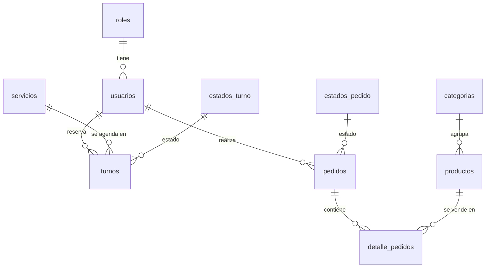

# TP6 – Normalización del esquema · Kora Hair

Proyecto: **Kora Hair – Tu Brújula Capilar** (salón y boutique capilar, Salta).
Alumna: Aramayo Dias Abigail Ayelén · Programación Web · Lic. Gabriel Artaza

## Parte 1 – Normalización aplicada al proyecto

### 1. Tabla principal SIN normalizar: `pedidos_sin_normalizar`

En la boutique, un cliente compra varios productos en un solo pedido. Si todo se guarda en una única tabla, queda así:

| id_pedido | cliente_nombre | cliente_email | cliente_telefonos | productos | cantidades | precios | categorias | estado_pedido | total |
|---|---|---|---|---|---|---|---|---|---|
| 1 | Abigail Aramayo | abigail@correo.test | 3871111111, 3872222222 | Reparador de Puntas, Shampoo Extra-Suave, Máscara Nutritiva Keratina | 1, 1, 1 | 14500, 11800, 18900 | Tratamiento, Limpieza, Nutrición | pagado | 45200 |
| 2 | Abigail Aramayo | abigail@correo.test | 3871111111, 3872222222 | Máscara Nutritiva Keratina | 2 | 18900 | Nutrición | pendiente | 37800 |

**Problemas que se observan**
- **Campos multivalorados:** `cliente_telefonos`, `productos`, `cantidades`, `precios` y `categorias` guardan varios valores en una sola celda.
- **Redundancia:** los datos del cliente se repiten en cada pedido; si cambia el email hay que modificarlo en muchas filas.
- **Anomalías:** no se puede cargar un producto sin que exista un pedido (inserción), borrar un pedido hace perder el producto (borrado) y cambiar un precio obliga a tocar muchas filas (actualización).

### 2. Proceso de normalización

#### Primera Forma Normal (1FN) – valores atómicos, sin grupos repetitivos
Regla: cada campo contiene un solo valor y no hay listas ni columnas repetidas.
Se separa cada producto del pedido en su propia fila y cada teléfono en su propia fila. Clave primaria compuesta: **(id_pedido, id_producto)**.

| id_pedido | id_producto | producto | categoria | precio | cantidad | cliente_nombre | cliente_email | estado_pedido |
|---|---|---|---|---|---|---|---|---|
| 1 | 1 | Reparador de Puntas | Tratamiento | 14500 | 1 | Abigail Aramayo | abigail@correo.test | pagado |
| 1 | 2 | Shampoo Extra-Suave | Limpieza | 11800 | 1 | Abigail Aramayo | abigail@correo.test | pagado |
| 1 | 3 | Máscara Nutritiva Keratina | Nutrición | 18900 | 1 | Abigail Aramayo | abigail@correo.test | pagado |
| 2 | 3 | Máscara Nutritiva Keratina | Nutrición | 18900 | 2 | Abigail Aramayo | abigail@correo.test | pendiente |

Los teléfonos pasan a una fila por teléfono (en el esquema final se simplificó a un `telefono` por usuario).

#### Segunda Forma Normal (2FN) – sin dependencias parciales de la clave
Regla: debe estar en 1FN y todo atributo no clave debe depender de **toda** la clave compuesta (id_pedido, id_producto), no de una parte.

Dependencias funcionales encontradas:
- `id_pedido → cliente_nombre, cliente_email, estado_pedido` → depende solo de **una parte** de la clave ❌
- `id_producto → producto, categoria, precio` → depende solo de **una parte** de la clave ❌
- `(id_pedido, id_producto) → cantidad` → depende de toda la clave ✔

Se descompone en tres tablas:

- **pedidos**(**id_pedido**, cliente_nombre, cliente_email, estado_pedido)
- **productos**(**id_producto**, producto, categoria, precio)
- **detalle_pedidos**(**id_pedido**, **id_producto**, cantidad, precio_unitario)

#### Tercera Forma Normal (3FN) – sin dependencias transitivas
Regla: debe estar en 2FN y ningún atributo no clave debe depender de otro atributo no clave.

Dependencias transitivas encontradas:
- En `productos`: `id_producto → categoria` y la categoría tiene su propia descripción (`categoria → descripcion`). Se extrae a **categorias**.
- En `pedidos`: `id_pedido → cliente_email → cliente_nombre` (los datos del cliente dependen del cliente, no del pedido). Se extrae a **usuarios**.
- En `pedidos`: `estado_pedido` es un texto repetido que se extrae a **estados_pedido**.
- En `usuarios`: el rol se extrae a **roles**.

Se agregan además las tablas del resto del sistema (servicios, turnos, consultas), que ya nacen normalizadas.

### 3. Listado de tablas resultante

**PK** = clave primaria · **FK** = clave foránea

| Tabla | PK | FK | Otros campos principales |
|---|---|---|---|
| `roles` | id | – | nombre, descripcion |
| `usuarios` | id | rol_id → roles.id | nombre, apellido, email (UNIQUE), password, telefono, activo, created_at, updated_at |
| `categorias` | id | – | nombre (UNIQUE), descripcion, created_at, updated_at |
| `productos` | id | categoria_id → categorias.id | nombre, descripcion, precio, stock, imagen, activo, created_at, updated_at |
| `servicios` | id | – | nombre, descripcion, duracion_min, precio, activo, created_at, updated_at |
| `estados_turno` | id | – | nombre (UNIQUE) |
| `turnos` | id | usuario_id → usuarios.id, servicio_id → servicios.id, estado_id → estados_turno.id | fecha_hora, notas, created_at, updated_at |
| `estados_pedido` | id | – | nombre (UNIQUE) |
| `pedidos` | id | usuario_id → usuarios.id, estado_id → estados_pedido.id | total, created_at, updated_at |
| `detalle_pedidos` | id | pedido_id → pedidos.id, producto_id → productos.id | cantidad, precio_unitario (UNIQUE pedido_id + producto_id) |
| `consultas` | id | – | nombre, apellido, email, motivo, mensaje, leida, created_at, updated_at |

### Diagrama entidad-relación

**Relaciones:** `roles` 1:N `usuarios` · `categorias` 1:N `productos` · `usuarios` 1:N `turnos` · `servicios` 1:N `turnos` · `usuarios` 1:N `pedidos` · **`pedidos` N:M `productos`** (resuelta con `detalle_pedidos`).

## Parte 2 y 3 – Scripts
- [`schema.sql`](./schema.sql): crea la base `kora_hair`, las 11 tablas con PK autoincrementales, FK, campos `created_at`/`updated_at` e índices.
- [`consultas.sql`](./consultas.sql): pruebas CRUD (INSERT, SELECT con WHERE/ORDER BY y INNER JOIN, UPDATE y DELETE con WHERE).

### Cómo ejecutarlos en XAMPP
1. Iniciar **Apache** y **MySQL** en el panel de XAMPP.
2. Abrir `http://localhost/phpmyadmin`.
3. Pestaña **SQL** → pegar el contenido de `schema.sql` → **Continuar**. Debe aparecer la base `kora_hair` con sus tablas.
4. Elegir la base `kora_hair` en la columna izquierda → pestaña **SQL** → pegar `consultas.sql` → **Continuar**.
